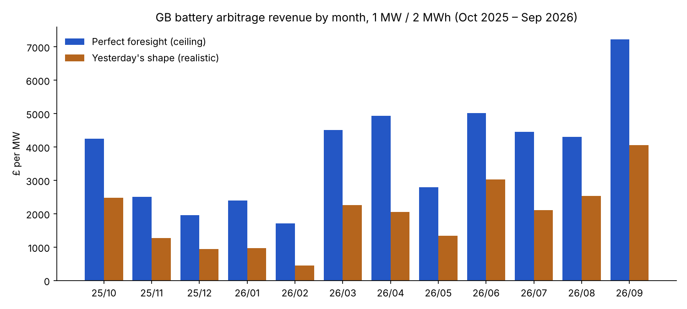

# GB Battery Arbitrage

How much could a grid battery have earned buying and selling power in Great Britain's wholesale market, and how much of that can a simple strategy actually capture?

## Why this matters

Batteries make money by charging when power is cheap (windy nights, sunny afternoons) and discharging when it's expensive (the evening peak). GB now has gigawatts of battery storage, and optimising these assets is a fast-growing part of energy trading. This project measures the opportunity on real prices.

## What it does

1. **Downloads real prices.** Half-hourly GB wholesale prices (Elexon Market Index Data, £/MWh) for any date range, cached locally.
2. **Models a realistic battery.** 1 MW / 2 MWh, 88% round-trip efficiency, and a £5/MWh wear cost on every MWh discharged, so it only trades when the spread is worth it. All of these are easy to change in `battery/model.py`.
3. **Finds the ceiling.** With perfect foresight, dynamic programming over the battery's state of charge finds the most money it could possibly have made.
4. **Tests a realistic strategy.** With no look-ahead, each day it trades the charge and discharge blocks that had the widest spread *yesterday*.
5. **Compares them.** The gap between the two is what a better price forecast is worth to a trader.

## Results: Oct 2025 – Sep 2026

17,508 real half-hourly prices (Elexon MID, APXMIDP). Average £95.49/MWh, range −£58.54 to £560.81, with 372 negative-price half-hours.

| Strategy | Revenue (£/MW/yr) | Cycles per day |
|---|---|---|
| Perfect foresight (ceiling) | **£46,063** | 1.45 |
| Yesterday's shape (no look-ahead) | **£23,491** | 0.98 |
| Share of ceiling captured | **51%** | |



What stands out:

- **A naive rule gets half the money.** Simply repeating yesterday's best charge/discharge window captures 51% of the theoretical maximum. The other £22.6k/MW/yr is what better forecasting is worth on this asset.
- **Spring and late summer pay most.** September 2026 was the best month (£7.2k ceiling) and February the worst (£1.7k). Solar-driven midday troughs widen the daily spread; flat winter days compress it.
- **The rule struggles most in winter.** Capture fell to about 26% in February and 40% in January, when the day-to-day shape changes most with wind, so yesterday is a poor guide.
- **Wholesale arbitrage alone is thin.** Around £23–46k/MW/yr is below what GB batteries have earned when balancing mechanism and ancillary services are added, which is why real optimisers stack revenues.

## Run it

```bash
pip install -r requirements.txt
python main.py                                   # the last 12 full months
python main.py --start 2025-01-01 --end 2026-01-01
pytest
```

The first run downloads a year of prices (about 365 small requests, a couple of minutes). After that it uses the saved copy.

## How it works

The perfect-foresight solver walks backwards through every half-hour, keeping track of the best possible profit for each level of charge. At each step the battery can charge, discharge or wait. Charging costs the price plus efficiency losses; discharging earns the price minus wear. Because it moves in full-power half-hour steps, the answer is exact for this model and runs in a second for a whole year.

## What's next

- Limit cycles per day, as real battery warranties do (the perfect-foresight run can cycle several times a day).
- Add the balancing mechanism and frequency-response services, which make up much of real battery revenue.
- Replace "yesterday's shape" with a forecast built from wind, solar and demand forecasts, and measure how much of the ceiling it recovers.
